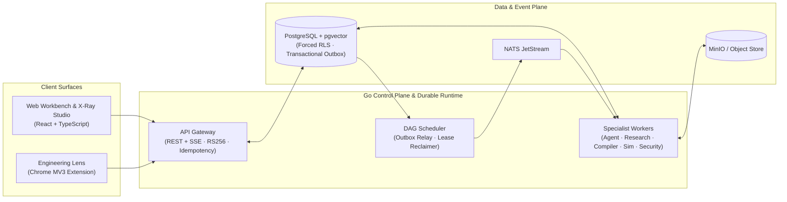

# Systera — Autonomous Engineering Intelligence Platform

<p align="left">
  
  
  
  
  
  
</p>

A browser-native, multi-agent engineering intelligence platform that investigates products, designs architectures (HLD/LLD), simulates behavior, adversarially reviews designs, compiles implementation artifacts, and continuously curates engineering knowledge.

See [Autonomous_Engineering_Intelligence_Platform_Technical_Architecture_v4.docx](./Autonomous_Engineering_Intelligence_Platform_Technical_Architecture_v4.docx) for the complete V4.0 specification.

## High-Level Architecture



## Repository Structure

```text
├── apps/
│   ├── web/                     # Web Workbench & Architecture Studio (TypeScript/React)
│   ├── chrome-extension/        # Engineering Lens (Chrome Manifest V3)
│   └── mobile/                  # Mobile Companion (Run monitor & approvals)
├── control-plane/               # Go-first Control Plane & Worker Binaries
│   ├── cmd/
│   │   ├── api/                 # REST + SSE API Gateway & Control Plane
│   │   ├── scheduler/           # Durable DAG task scheduler & lease reclaimer
│   │   ├── worker-agent/        # Specialist agent execution worker
│   │   ├── worker-research/     # Engineering Pulse & research worker
│   │   ├── worker-compiler/     # Sandboxed Architecture Compiler worker
│   │   ├── worker-simulation/   # Digital Twin simulation worker
│   │   └── worker-security/     # Red Team adversarial review worker
│   ├── internal/                # Bounded-context domain & platform packages
│   ├── migrations/              # PostgreSQL schema & Row-Level Security migrations
│   └── test/                    # Integration & tenant-isolation tests
├── workers/                     # Polyglot compute-plane adapters
├── contracts/                   # Versioned OpenAPI, NATS events, agent & graph contracts
├── schemas/                     # Canonical JSON Schemas & Protobuf definitions
├── knowledge/                   # Engineering Pulse sources, benchmarks & Architecture Genome
├── deployments/                 # Docker Compose, Helm, Terraform & security policies
└── docs/                        # Architecture docs, ADRs, runbooks & threat models
```

## Stage 0 Quickstart

1. **Copy environment configuration** and generate a local RS256 signing keypair (the API will not start without a verification key):
   ```bash
   cp .env.example .env
   make keys    # writes .secrets/auth_private.pem + auth_public.pem (gitignored)
   ```

2. **Start local data & event plane** (PostgreSQL + `pgvector`, Redis, NATS JetStream, MinIO):
   ```bash
   make up
   ```

3. **Apply database migrations** (Tenants, Users, Projects, Design Runs, Transactional Outbox, Audit Events, enforced RLS):
   ```bash
   make migrate-up        # embedded, versioned, idempotent; `make migrate-status` to inspect
   ```

4. **Create a tenant and owner, then mint a token**:
   ```bash
   make bootstrap SLUG=acme EMAIL=you@acme.test NAME="You"
   export TOKEN=$(make -s token EMAIL=you@acme.test)
   ```

5. **Build and test the Go backend**:
   ```bash
   make build
   make test               # unit + HTTP tests (in-memory adapters)
   make test-integration   # end-to-end against the local PostgreSQL
   ```

6. **Run the Control Plane API** (or `docker compose -f deployments/docker/docker-compose.yml --profile api up -d`):
   ```bash
   make run-api
   curl localhost:8080/healthz    # liveness
   curl localhost:8080/readyz     # 503 until Postgres, schema and event listener are all OK
   ```

7. **Create a project and a run, and watch it live**:
   ```bash
   P=$(curl -s -H "Authorization: Bearer $TOKEN" -d '{"name":"URL Shortener"}' localhost:8080/v1/projects | jq -r .id)
   R=$(curl -s -H "Authorization: Bearer $TOKEN" -H 'Idempotency-Key: demo-1' \
         -d '{"objective":"Design a URL shortener"}' localhost:8080/v1/projects/$P/runs | jq -r .id)
   curl -N -H "Authorization: Bearer $TOKEN" localhost:8080/v1/runs/$R/events   # stays open
   # in another shell:
   curl -X POST -H "Authorization: Bearer $TOKEN" localhost:8080/v1/runs/$R/cancel
   ```

## Control Plane Guarantees (Stage 0)

| Concern | Behaviour |
| :--- | :--- |
| **Durability** | Projects, runs, outbox events and audit records live in PostgreSQL. The API requires the database at startup; restarting loses nothing. |
| **Authentication** | Every `/v1` request needs `Authorization: Bearer <JWT>` (RS256 only, keys >= 2048 bits; signature, `iss`/`aud`/`exp`/`nbf` checked). `sub` is matched to `users.external_sub`; tenant and role come from an *active* `tenant_memberships` row. `X-Tenant-ID` only selects among the caller's verified memberships; `X-User-ID`/`X-Role` are ignored. `VIEWER` is read-only. |
| **Tenant isolation** | Tenant-scoped queries run as the non-owner role `systera_app` with `app.current_tenant_id` bound per transaction, so PostgreSQL RLS (forced) is enforced in addition to explicit `tenant_id` filters. |
| **Transactional outbox** | A run and its `run.created` event (and every state change and its `run.state_changed` event) commit in one transaction. If the event cannot be recorded the request fails and nothing is persisted. |
| **Idempotency** | `Idempotency-Key` is scoped to (tenant, project). A replay of the same normalized request returns the original run with `Idempotent-Replayed: true`; the same key with a different body returns `422 idempotency_key_conflict`. Requests without a key are never deduplicated. |
| **Live events** | `GET /v1/runs/{id}/events` replays the backlog, then streams new events as they commit (LISTEN/NOTIFY, with a poll fallback). SSE ids are outbox sequence numbers, so `Last-Event-ID` resumes without gaps. The stream ends with `stream.end` once the run is terminal. |
| **Readiness** | `/readyz` returns 503 unless PostgreSQL answers, every embedded migration is applied, and the outbox listener is connected. `/healthz` is liveness only. |

**Identity provider note:** the API only needs public keys. Locally, `make keys` + `systera-admin token` sign tokens with a private key the API never sees. In production, set `SYSTERA_AUTH_JWKS_URL` to your IdP's JWKS endpoint (keys are cached for 5 minutes, refetched on an unknown `kid` at most every 10 seconds, and the last good key set is kept if the IdP is unreachable), along with the IdP's `iss`/`aud` values; map each user's IdP `sub` to `users.external_sub` via `systera-admin bootstrap -subject`.

## Stage 1 — Durable Agent Core

```text
POST /v1/runs/{id}/plan ──► agent_tasks DAG (PENDING/READY) ──► worker-agent leases READY tasks
        │                                                         │  Model Gateway (budgeted)
        │                                                         │  Tool Gateway (allowlist + capability + schema)
        ▼                                                         ▼
  outbox_events ◄── every run/task change, same transaction ── heartbeat · checkpoint · complete/fail
        │
        └─► scheduler: outbox relay ──► NATS JetStream (systera.events.run.*, systera.events.task.*)
                       lease reclaimer · budget-starvation checks
```

Run it locally (after the Stage 0 steps, with `make up` for NATS and Ollama serving a model):

```bash
make run-api            # terminal 1
make run-scheduler      # terminal 2
make run-worker         # terminal 3 (SYSTERA_MODEL_PROVIDER=groq|openrouter|huggingface + API key for hosted free models)

curl -H "Authorization: Bearer $TOKEN" -d '{"tasks":[
  {"key":"functional","agent_type":"requirements_analyst","objective":"List the functional requirements"},
  {"key":"nfr","agent_type":"requirements_analyst","objective":"Derive quantified NFRs","depends_on":["functional"],
   "granted_capabilities":["task.read","run.read"],"max_tool_calls":2}]}' localhost:8080/v1/runs/$R/plan
curl -H "Authorization: Bearer $TOKEN" localhost:8080/v1/runs/$R/tasks
```

| Concern | Behaviour |
| :--- | :--- |
| **DAG plans** | Validated before persistence: unique keys, known dependencies, no cycles (Kahn), registered agents, per-task budgets within the run budget. The run walks `CREATED → PLANNING → PLAN_VALIDATING → READY → RUNNING` in one transaction; root tasks become `READY`, dependents become `READY` only when every upstream task has `SUCCEEDED`. |
| **Leases** | Workers claim with `FOR UPDATE SKIP LOCKED`; every lease carries a fencing token (`task_attempts.id`). Heartbeats extend it (every TTL/3); heartbeats, checkpoints and completions from a stale token fail with `ErrLeaseLost`. The scheduler reclaims expired leases and retries with exponential backoff up to `max_attempts`. |
| **Budgets** | A claim reserves `task.budget_usd` on the run and only succeeds if `spent + reserved + budget <= max_budget_usd`; completion releases the reservation and charges actual model cost. Overspend fails the run (`budget_exceeded`); a run whose remaining tasks can no longer fit fails (`budget_exhausted`). The Model Gateway caps `max_tokens` so a call's worst case fits the task's remaining budget, and refuses to call at all if it can't. |
| **Checkpoints & results** | Each model call records a `PROGRESS` checkpoint; every finished attempt records a `RESULT` checkpoint. `result_json` always holds the latest attempt's AgentResult: on failure a contract-shaped `status: FAILED` result with `error.code` (`agent_declared_failure` keeps the agent's own summary/output/open questions; otherwise `invalid_agent_response`, `provider_error`, `budget_exceeded`, `attempt_timeout`, `model_call_limit`, …). A retried attempt receives the last checkpoint. |
| **Outbox relay** | `cmd/scheduler` publishes committed `outbox_events` to JetStream with `Nats-Msg-Id = event_id` (dedup window 2 min), then sets `published_at`. Events are hashed into 16 partitions by `run_id` (`tenant_id` for run-less events); a replica relays a partition only while holding its advisory lock, in `seq` order, stopping at the first failure. Any number of replicas therefore deliver **each run's events exactly in commit order**; there is no ordering across runs. Publish errors are recorded on the row and block only their partition. |
| **Model Gateway** | Provider-neutral (`internal/models`) over the OpenAI-compatible chat-completions API, with presets for hosted free open-weight models (`groq`, `openrouter` `:free` models, `huggingface`) and local Ollama (`openai`). The worker refuses to start if a hosted preset has no key or the provider no longer serves the configured model. Every model must be priced (`SYSTERA_MODEL_PRICING`; 0 for free/local models); usage and cost are recorded per attempt. 429/5xx/timeouts are retryable; 4xx and budget errors are not. |
| **Tool Gateway** | Before any handler runs: tool registered → on the agent's allowlist → capability granted to the task → per-task call budget → arguments valid against the tool's JSON schema (closed objects by default). Output schemas are enforced too. |
| **Contracts** | Workers send `AgentTaskEnvelope` v1 and store `AgentResult` v1 (`contracts/agents/`) as `agent_tasks.result_json`; NATS messages follow `contracts/events/event-envelope.v1.json`. |
| **Background RLS** | Relay, scheduler and workers assume `systera_system`, which has explicit permissive policies (RLS stays forced; no `BYPASSRLS`, which RDS cannot grant). |

## Stage 2.1 — Canonical architecture graph (data model)

Migration `000004_architecture_graph` and `internal/graph` store one typed, versioned model per project in PostgreSQL adjacency tables (no graph database, per spec §29).

| Table | Purpose | Guarantees enforced by the database |
| :--- | :--- | :--- |
| `architecture_models` | One model per project; `current_version_id` | Identity immutable; current version only moves forward, within the model |
| `architecture_versions` | Immutable, linear versions `0..n` with `graph_hash`, counts, author, patch | No updates/deletes; parent is exactly the previous version of the same model and tenant; one root |
| `architecture_nodes` / `architecture_edges` | Append-only temporal rows: stable `node_id`/`edge_id`, each revision valid for `[valid_from_version, valid_to_version)` | Only permitted update is closing an open revision; no overlapping revisions (GiST exclusion); unique node key per version; type/endpoints/model fixed for a node/edge's life; contiguous revision numbers; edges' endpoints live for the edge's whole lifetime (deferred check at commit); typed node/relation vocabularies |
| `graph_patches` | GraphPatch v1 change sets: base version, operations, idempotency key + fingerprint, risk, approval, result, resulting/rollback version | Unique idempotency key per model; content immutable; decided patches frozen; `ACCEPTED` requires a resulting version and approval |
| `graph_invariants` | Registry of invariants and where each is enforced (`DATABASE` now, `GRAPH_SERVICE` in 2.2+) | — |
| `graph_snapshots` | Published versions | Immutable; must match the version's tenant, number and graph hash |

All tenant tables have forced RLS for `systera_app` (tenant-bound) and `systera_system`; neither role can `DELETE`, and versions/snapshots are insert-only. The graph at any version is every row whose range contains it, so history is fully reconstructable. `graph.Hash` is the canonical content hash (sorted, storage fields excluded). `Store.Reachable` is a single recursive CTE with visited-set semantics (terminates on cycles) for impact-style traversal (`in`), dependency walks (`out`) or both, with relation filters and a node cap; a 2,000-node / 2,283-edge model traverses in ~0.2 s.

## Stage 2.2 — Graph service & mutation protocol

Every change to an architecture model is a **GraphPatch** (`contracts/graph/graph-patch.v1.json`) submitted to `POST /v1/architecture/{model_id}/patches`; the outcome is a **GraphPatchResult** (`graph-patch-result.v1.json`).

| Concern | Behaviour |
| :--- | :--- |
| **Single writer** | Only `internal/graph` assumes the `systera_graph` role, the sole role with write privileges on graph tables. The app/system roles (API handlers, agents, workers, scheduler) are read-only on the graph, so nothing can bypass patches. |
| **Validation** | Strict per-op payloads; tenant scope; references (endpoints may be added earlier in the same patch); never-reused ids; unique keys; the typed vocabulary and **edge compatibility matrix** (`graph.RelationRules`, e.g. `writes` must target a data store, `replicates` must join like resources); rationale on every op; removals with live edges need `cascade_edges`; no dangling edges; no-op patches rejected; `expected_invariants` must be registered and active; `run_id`/`agent_task_id` must belong to the model's project. All findings are returned together (422 `REJECTED`). |
| **Optimistic concurrency** | Patches are serialized per model; `base_graph_version` must equal the current version, otherwise 409 `CONFLICT` with per-operation conflicts (`modified_since_base`, `removed_since_base`, `key_taken_since_base`, `endpoint_removed_since_base`, with the version that changed it) and `changes_since_base`. Eight concurrent writers on one base yield exactly one accepted version. |
| **Versions** | An accepted patch creates exactly one immutable version with the canonical `graph_hash` (also the `ETag` of `GET .../versions/{n}`), node/edge counts, a change summary, author and patch id; the patch records its resulting and rollback versions. |
| **Idempotency** | `idempotency_key` (body or `Idempotency-Key` header) per model: a replay returns the recorded outcome (any status) with `Idempotent-Replayed: true`; a different body is 422 `idempotency_key_conflict`. |
| **Events & impact** | `architecture.graph.version.created` (Appendix D payload plus `graph_hash`, `changed_edge_ids`, `impacted_node_ids`) is written to the outbox in the same transaction and relayed to JetStream. `impacted_components` = changed nodes plus everything that transitively depends on them. `invalidated_artifacts` is empty until artifact bindings land (checklist 6.x). |
| **Queries** | `GET /v1/projects/{id}/architecture`, `.../versions`, `.../versions/{n|current}`, `.../diff?from=&to=` (semantic, with changed fields), `.../nodes/{id}/neighbourhood?depth=&direction=&relation=`, `.../patches/{id}`. |

## Stage 2.4 — Evidence ledger, claims & assumptions (spec §23.11)

Migration `000007_evidence_ledger`, package `internal/evidence`, routes under `/v1/architecture/{model_id}/{evidence,assumptions,claims}`.

| Record | What it holds | Guarantees |
| :--- | :--- | :--- |
| `evidence_records` | Source ref, source type (→ DIRECT/INDIRECT), SHA-256 content hash, excerpt, captured_at, trust level, access policy, expiry | Immutable content; status ACTIVE → EXPIRED/REVOKED once; capture is idempotent per (source, hash); citable from GraphPatches as `evidence:<id>` (validated: exists, ACTIVE, unexpired) |
| `assumptions` | Statement, rationale, owner, risk if wrong, validation method, subject nodes, expiry | Explicit records, never implied facts; immutable statement; ACTIVE/VALIDATED/NEEDS_REVALIDATION → INVALIDATED/RETIRED (final) |
| `claims` | Statement, class OBSERVED/INFERRED/PROPOSED, reasoning, confidence band (+ optional score inside the band), subject nodes, graph version, review state, lifecycle ACTIVE/STALE/RETRACTED/SUPERSEDED, expiry or rolling `revalidate_after` | Content immutable (edits supersede); independent review (author ≠ reviewer, in a CHECK); RETRACTED/SUPERSEDED final |
| `claim_evidence`, `claim_assumptions` | SUPPORTS / CONTRADICTS / CONTEXT links; dependencies on assumptions | Same-model only (composite FKs); append-only |

**Rules (Appendix D), enforced at commit by `claim_requirements_unmet()` and reported up-front as findings:** every ACTIVE claim must be unexpired and rest only on ACTIVE/VALIDATED, unexpired assumptions; OBSERVED needs supporting active direct evidence and may not rest on assumptions; INFERRED needs reasoning plus supporting active evidence; PROPOSED is a recommendation. HIGH confidence needs VERIFIED/HIGH-trust support and no high-trust contradiction.

**Revalidation (4.4):** revoking evidence or invalidating/retiring an assumption marks dependent claims STALE in the same transaction; the scheduler's sweep expires evidence, moves expired assumptions to NEEDS_REVALIDATION and marks every ACTIVE claim that no longer satisfies the rules STALE (with the failed rule as `stale_reason`), emitting `evidence.expired`, `assumption.status_changed` and `claim.stale`. `POST .../claims/{id}/revalidate` re-establishes a claim only if, with any fresh evidence, it satisfies the rules again.

## Stage 3.2 — Engineering Pulse (spec §2.2, §6.5, §20.2)

Migration `000013_engineering_pulse`, package `internal/engineeringpulse`, worker `cmd/worker-research`, admin `systera-admin pulse-*`, routes `/v1/trends/*` and `/v1/knowledge/{updates,subscriptions,notifications,patterns}`.

```
trend_sources (approved registry) → connectors (RSS/Atom, arXiv, GitHub releases) → trend_items + retrieval metadata
  → dedup to a canonical item (EXACT / MIRROR / REPOST / VERSION / NEAR_DUPLICATE)
  → taxonomy (trend_topics: DOMAIN › TECHNOLOGY / PATTERN, maturity) → trend_observations (daily)
  → trend_scores  Score = 0.25P + 0.25G + 0.20E + 0.20R + 0.10N  (generated column; each part 0–100)
  → research_reports (primary-source evidence, limitations, caveats, confidence, freshness)
  → validation gate (12 checks; re-enforced by a trigger on knowledge_updates)
  → PUBLIC knowledge document `pulse:<topic>` (new version supersedes the old) → agent_knowledge_notifications
  → retrieval in design runs with "why relevant" + supporting sources (run_knowledge_references)
```

| Step | Guarantees |
| :--- | :--- |
| Registry (2.1) | `knowledge/source-registry/sources.json` defines sources with terms URL + summary, licence, allowed content (`METADATA_ONLY`/`SUMMARY`/`FULL_TEXT`), per-hour rate limit and minimum interval. Synced sources start `PENDING_REVIEW`; only `systera-admin pulse-approve -source K -by NAME` lets them be fetched (a CHECK requires approver + terms). Changing terms/content/feed on an approved source returns it to review. |
| Connectors (2.2) | Claimed with `FOR UPDATE SKIP LOCKED`; every attempt is logged in `trend_source_fetches` and counts against the rolling-hour limit. Conditional GET (ETag / Last-Modified), 5 MB cap, no off-host redirects, generic crawler User-Agent, `Retry-After` honoured, exponential back-off, suspension after 10 consecutive failures. Text beyond the allowed content is dropped before storage. |
| Dedup (2.3) | Exact content hash → canonical URL (tracking params, `www.`, AMP stripped) → series (arXiv `vN`, edited posts; newest wins) → same title from another source → bigram SimHash ≤ 10 bits. A primary source replaces a non-primary copy as canonical. |
| Classify (2.4) | Word-boundary keyword rules (title ×2); technology/pattern matches imply their domain; maturity from deprecation/experimental/beta/GA signals; engineering significance from source type and breaking-change / security / performance / architecture signals. `Classifier` is an interface for a model-backed version. |
| Score (2.5) | P saturating attention (mentions incl. mirrors + engagement), G `50+50·tanh(ln(cur+1)/(prev+1))`, E top-item significance, R reliability + primary share + source diversity, N recency of first sighting + burst vs baseline. Go and the DB column must agree or the write fails. |
| Research (2.6) | Re-runs only when the evidence set changes. Technical findings cite one item each; attention is a separate `ADOPTION` finding. Confidence bands: HIGH requires ≥ 2 sources and a primary one. `stale_after` = newest evidence + maturity TTL (90–365 days), never extended. |
| Gate (2.7) | primary evidence, canonical evidence, approved sources, every finding cited, technical proof from a primary source, limitations, maturity + adoption caveats, calibrated & sufficient confidence, freshness, complete provenance, no prompt-injection text. Rejected reports are kept with their failed checks. |
| Distribute (2.8) | Publish = knowledge document (PUBLIC, `tenant_id NULL`, searchable by every tenant) + `knowledge_updates` + one notification per matching subscription (topic or any ancestor, `min_confidence`), and `pg_notify('engineering_pulse_knowledge')`. A sweep marks knowledge past `stale_after` STALE. |
| Guardrail (2.9) | `POST /v1/trends/compare` / tool `pulse.compare_options` rank options on maturity, operational burden, cost, security and fit (all required, with rationale). Trend score only breaks ties within 2 points; deprecated options are excluded; disagreements are reported as warnings. Every retrieved pattern carries `adoption_signal.selection_criterion: false`. |
| MVP (2.10) | The agent runner injects up to three relevant patterns (framed as untrusted data, with why/sources/limitations) before the task envelope and records them; agents can also call `pulse.patterns`. `GET /v1/runs/{id}/knowledge` shows what a run used and why. |

Run it: `SYSTERA_PULSE_REGISTRY_FILE=knowledge/source-registry/sources.json go run ./cmd/worker-research` (cycle every `SYSTERA_PULSE_INTERVAL`, default 15m; optional `SYSTERA_GITHUB_TOKEN`), or `systera-admin pulse-run` for one cycle.

## Stage 3.3 — Engineering Lens: backend and MV3 extension (spec §2.3, §7, §20.3)

Migrations `000014_browser_intelligence`, `000015_engineering_lens`; package `internal/browserintel`; extension `apps/chrome-extension` (`npm install && npm run build`, then load the folder unpacked; `npm test`).

| # | Guarantee |
| :--- | :--- |
| 3.1 Extension | Side panel (React), service worker, on-demand collector (`dist/content.js`, injected only when you click Scan), DOM sanitizer, collectors (headings, navigation, features, visible text, forms, public metadata, resource timing), API client. Bundled with esbuild. |
| 3.2 Permissions | Always: `activeTab`, `storage`, `sidePanel`. Optional, requested with an explanation when needed: `scripting` (first scan), the workspace API origin (sign-in), the investigated site's origin (multi-page; removed when the investigation ends). No host permissions or content scripts up front. |
| 3.3 Collection | One exclusion rule for every collector: hidden / aria-hidden / template / editable / `data-private` / personal-data containers (account, profile, billing…) are skipped. Never read: field values, password / hidden / file / payment fields, cookies, storage, history, request bodies, scripts. URLs lose credentials, fragments and secret parameters; resource URLs keep origin + path only. A lint test fails the build if collector code touches `.value`, `document.cookie`, storage, history, the network or `innerHTML`. |
| 3.4 Consent | Scan → per-item preview (uncheck anything) → consent text from `GET /v1/browser/consent` → send. Cancel discards locally. The session records consent version and time (DB CHECK requires consent). |
| 3.5 Auth | `POST /v1/auth/lens-token` exchanges a workspace token for an RS256 token with `scope: lens`, `tid` pinned, ≤ 1 h. Scoped tokens are refused if longer-lived, unpinned or carrying unknown scopes, and can only reach `/v1/browser/*` and `/v1/websites*`. The extension keeps only lens tokens, in `chrome.storage.session`. `systera-admin token -scope lens -tenant … -ttl 15m` mints one for development. |
| 3.6 Observation API | Strict schema 1.0 (unknown fields rejected), 256 KiB cap, page must be on the session domain and — in multi-page mode — one of the selected pages, at most once, within `max_pages`. Sessions are personal (others get 404; tenant OWNER/ADMIN may read and delete). Stored observations are `untrusted`; `FrameForAgent` wraps them in `<untrusted_observation>` with injection warnings. |
| 3.7 Re-sanitization | The server re-applies every exclusion (secrets, PII, phone/SSN/card shapes, URL credentials and secret params, route/resource/form-action queries, protocol-relative routes, non-public metadata, malformed client labels) regardless of what the client claims. |
| 3.8 Deletion & retention | Deleting a session cascades through observations and profiles; deleting one page deletes the profiles derived from it. Both return counts and are audited. Expired sessions accept nothing and are deleted by the scheduler's sweep. |
| 3.9 Multi-page | Candidate pages come from the scanned page's own same-origin routes; the user picks up to `max_pages − 1`; the extension visits each in the current tab, previews all, and sends only after consent. |
| 3.10 Continue in workspace | Creates a project + architecture model seeded with a `system` node and the PROPOSED services (graph patch), idempotently; concurrent promotions create exactly one project. |

## Stage 3.4 — Website intelligence agents (spec §8)

Migrations `000016_website_intelligence_agents`, `000017_website_agents_wiring`; `internal/browserintel` (`agents.go`, `intel.go`, `techsignals.go`); tools in `internal/agent/website_tools.go`.

| # | Guarantee |
| :--- | :--- |
| 4.1 Agents | Product Discovery, User Journey, Technology Signal, Domain Architect, Architecture Hypothesis, Database Architect, API Architect, Infrastructure, Independent Reviewer. Tools: `website.observations` (pages framed as untrusted data, plus findings so far), `website.record_finding` (all but the reviewer), `website.review_findings` (reviewer only, recorded on the ledger claims; authors cannot review themselves). |
| 4.2 Plan | `POST /v1/websites/{id}/analysis` promotes the investigation, creates a design run and submits the DAG through the scheduler: discovery and technology signals in parallel → journeys → domains → hypothesis / database / API → infrastructure → **Independent Reviewer last** (depends on every task). Capabilities granted per task match the tools' checks. |
| 4.3 Evidence | Every finding is OBSERVED / INFERRED / PROPOSED. Once promoted, each observation is DIRECT ledger evidence (only a hash and excerpt are stored) and each finding a claim citing exactly its pages (OBSERVED/INFERRED: SUPPORTS, PROPOSED: CONTEXT). Rules, enforced in code and by CHECKs: only capabilities and journeys can be OBSERVED; INFERRED needs cited pages and a rationale; cited pages must belong to the investigation; findings copying instruction-like page text are refused. A finding and its claim stand or fall together. Deleting a page (or the investigation, or retention expiry) revokes its ledger evidence, so dependent claims turn STALE. |
| 4.4 Passive signals | Technology signals come only from what the page already loaded and the user previewed (resource URLs, public metadata, routes); the package imports no HTTP client. Each signal is INFERRED, quotes its clue (which must appear in a cited observation) and has a confidence; text describing scanning, probing, fuzzing, brute force or exploitation is rejected. |
| 4.5 Outputs | `website_profiles`, `website_capabilities`, `architecture_hypotheses`, `architecture_evidence` (`GET /v1/websites/{id}`, `/capabilities`, `/hypotheses`, `/evidence`). Baseline findings are regenerated on re-analysis (their claims retracted); agent findings keep their agent, run and task. |
